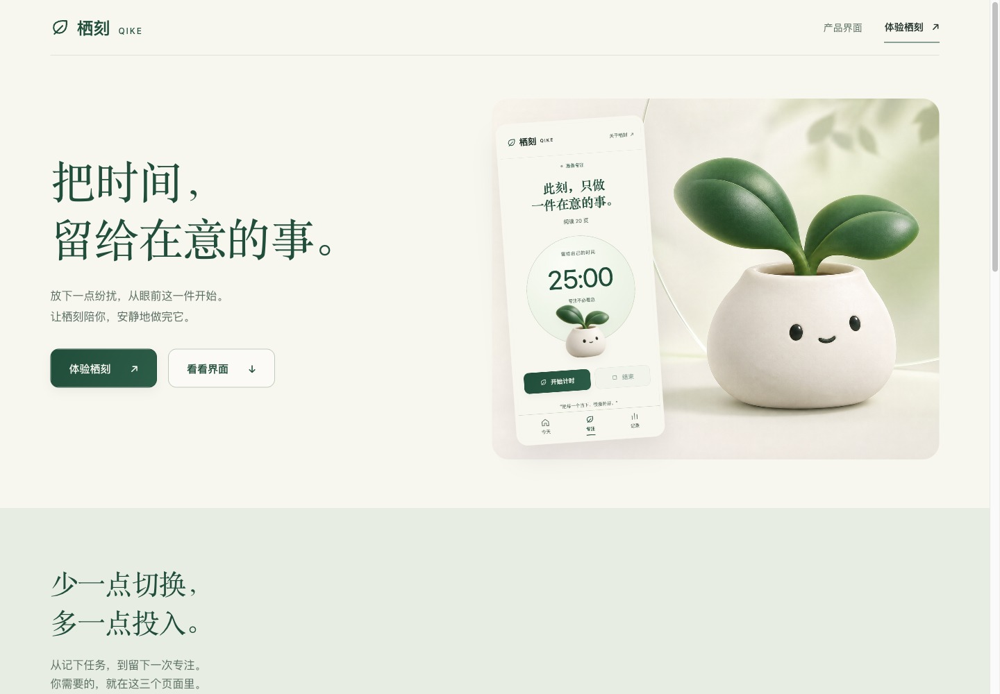

# APP UI Studio

将品牌、产品任务和参考图转成多屏 APP / SaaS、宣传页、可交互代码与可审查证据。插件为技能编排与本地辅助脚本，不内置模型服务或新的MCP服务器。



## 快速体验

```bash
git clone https://github.com/pengchengwanli2024/app-ui-studio.git
cd app-ui-studio
python3 -m http.server 8820 --bind 127.0.0.1
```

打开 [1.1 / 1.2 对比页面](http://127.0.0.1:8820/examples/qike/comparison.html)、[栖刻 1.2](http://127.0.0.1:8820/examples/qike/v1.2.0/index.html) 或 [宣传页](http://127.0.0.1:8820/examples/qike/v1.2.0/landing.html)。示例无npm依赖、账号或后台，初始统计明确为示例数据。

## 插件

当前源码版本 **1.3.0**。`plugins/app-ui-studio/` 是一个独立、可打包的 Agent Plugins 1.0 插件目录。按宿主支持的本地插件或ZIP导入流程加载；插件中的技能入口是 `$app-ui-studio`，路由参数不是MCP工具。

本轮发布的是独立源码与安装包；发布前账号插件已由并行工作更新到2.0.0，本轮保留该更新，未覆盖或降级。完整实测仍以冻结的1.1/1.2版本为准。

```text
$app-ui-studio design 为我的产品制作一致的多屏界面
$app-ui-studio saas scope=existing surface=both tone=tech-refined
$app-ui-studio marketing 制作同品牌宣传页
$app-ui-studio compare 对比同一产品的两个已冻结版本
```

```bash
python3 scripts/package_plugin.py --output /tmp/app-ui-studio.zip
```

图像、浏览器和设计编辑器依赖宿主实际能力。四项设计技能是可选外部依赖，不随本仓库复制安装；缺少时明确降级。插件不保存账户、密钥或用户项目图片。

## 本轮升级与实测

- 1.2新增的已有项目/SaaS配置、浅色科技表达与素材证据链，在同一「栖刻」示例上按实际适用范围测试；没有把个人专注APP伪装为SaaS业务。
- image产出三屏方向稿，Lovart产出宣传主视觉。方向稿与真实组件截图分别标记；合格品牌素材复用，业务JS保持一致。
- 1.3加入版本冻结、同状态对比流程和 `compare`：核对版本标签、目录内证据、业务/品牌哈希及真实PNG/JPEG头部尺寸。输出始终 `visual_quality_verified=false`。
- 一轮Harness²四个独立条件在相同契约下执行；没有普适改善证据时保留baseline。实验结果与真实页面验收分开，原始失败保留在本地，公开证据已脱敏。

参阅 [实测与对照报告](docs/TEST_REPORT.md)、[Harness²结果及限制](docs/harness-results.md)、[比较计划](docs/qike-comparison-plan.md)、[机器可读比较结果](evidence/comparison.json)。

## 本地验证

需要Python 3.11+；JavaScript语法检查使用Node。脚本不调用付费模型。

```bash
python3 tests/test_contracts.py
python3 scripts/verify_project.py
node --check examples/qike/v1.2.0/app.js
python3 plugins/app-ui-studio/skills/app-ui-studio/scripts/studio.py compare examples/qike/v1.1.0/capture.json examples/qike/v1.2.0/capture.json
```

`compare`退出0=文件契约有效且可比，1=有效但条件不同，2=无效。它不自动评判审美、截图真实性、提供方是否执行或原生设备质量。使用 `--output` 仅创建新报告，已有文件拒绝覆盖。

## 许可与来源

原创代码和文档采用 [MIT](LICENSE)。生成素材、文章改编与外部技能的范围见 [NOTICE](NOTICE.md)。四项上游技能不被重新授权；仓库没有文章示例IP、系统字体文件、私有账户回执或本机目录配置。
