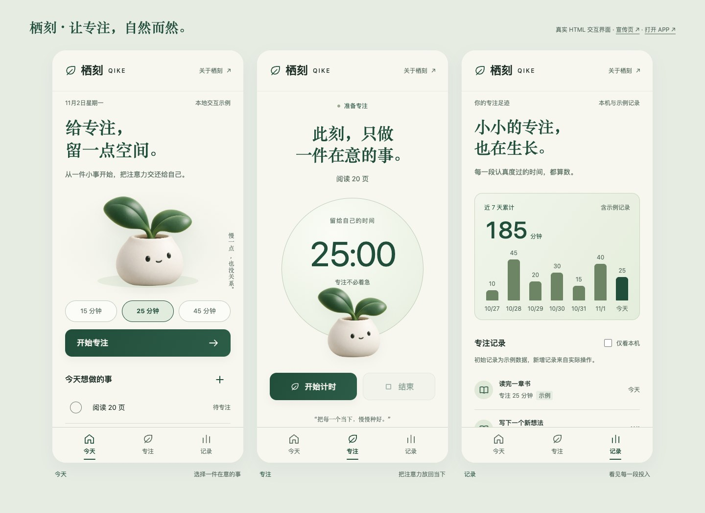
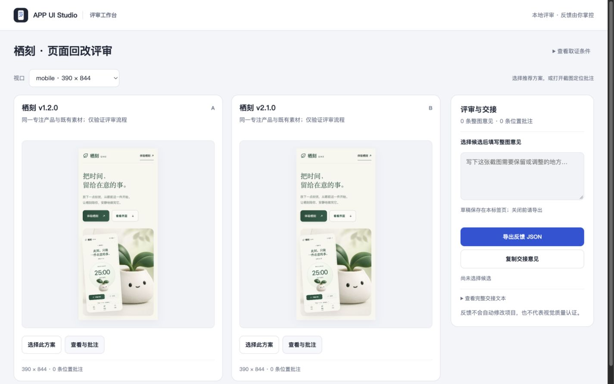

# APP UI Studio

将品牌、产品任务和参考图转成多屏 APP / SaaS、宣传页、可交互代码与可审查证据。插件为技能编排与本地辅助脚本，不内置模型服务或新的MCP服务器。



## 2.7 现代Web方法与实际审计

按问题接入GoogleChrome的Modern Web Guidance、源码仓库的预期/反例与支持信息、Lighthouse的环境记录和串行比较方法。只加载当前问题需要的指导，不强制安装上游、加入遥测或给所有项目套100分门槛。原业务/品牌与冻结提示词继续保留。

```bash
python3 plugins/app-ui-studio/skills/app-ui-studio/scripts/studio.py workflow --focus web-quality --platform mobile --format json
python3 plugins/app-ui-studio/skills/app-ui-studio/scripts/studio.py web-report reports/current.json --baseline reports/baseline.json --output reports/summary.json
```

`web-quality`默认只读；`web-report`只导入单个Lighthouse JSON，不运行浏览器或修改产品。保留零值/缺失/手工/错误，比较条件不同不产出差值。方法与工具边界见[现代Web指导](plugins/app-ui-studio/skills/app-ui-studio/references/modern-web.md)，固定来源见[三仓库目录](plugins/app-ui-studio/skills/app-ui-studio/assets/web-quality-sources.json)。本轮实测与剩余限制见[验证记录](evidence/v2.7.0/verification.json)。

## 2.6 用自身产品完成改版验证

重新设计真实的评审工作台，并制作配套产品介绍页：共享视觉变量、同屏候选与交接、保持比例的预览和定位批注；原创生成纸张与定位环素材，宣传页采用可往返的三段滚动叙事，手机与无脚本保留顺序图文。工作台继续使用原生滚动，原反馈与图片身份契约保持兼容。

```bash
python3 scripts/build_site.py --output /tmp/app-ui-studio-site
python3 -m http.server 8846 --directory /tmp/app-ui-studio-site
```

打开本地 `http://127.0.0.1:8846`；构建目录包含实际可操作的工作台，无外部部署。源码在 [site](site/index.html)，需先构建以接入生成的评审路由。[实际验证与限制](evidence/v2.6.0/verification.json) · [素材提示词与来源](evidence/v2.6.0/media.json) · [真实回改意见](evidence/v2.6.0/redesign-feedback.json)。



## 2.5 定位反馈与实际项目验证

继续核对剩余非Fork项目的入口和实现片段，现有72个提交定位、39个实现抽样，40个项目的方法进入按需指导。补充稳定对象ID、选择范围、本地状态版本、公开扩展接口与批次产物映射；Fork继续保留第三方归属，不把源码抽样当作完整审计或上游运行验收。

截图对比页新增位置批注、按候选/屏幕分开的整图意见、本标签页草稿和JSON导出，修复切换候选后旧意见被重绑的问题。每条意见携带截图文件、尺寸、SHA-256与归一化位置，交接前用`board-feedback`核对真实图片字节。

```bash
python3 plugins/app-ui-studio/skills/app-ui-studio/scripts/studio.py board examples/review-board.json --output /tmp/studio-qike-review
python3 plugins/app-ui-studio/skills/app-ui-studio/scripts/studio.py board-feedback /tmp/studio-qike-review/board.json evidence/v2.5.0/board-feedback.json
```

本轮在实际运行的对比页中，使用栖刻已有真实渲染验证390px/1440px布局、两处定位、候选/视口隔离、刷新恢复、多标签隔离、移除和浏览器文件导出。[实际验证](evidence/v2.5.0/verification.json) · [桌面截图](evidence/v2.5.0/board-desktop.jpg) · [手机截图](evidence/v2.5.0/board-mobile.jpg)。验证的是评审流程；历史栖刻画面不被用作本轮视觉升级证明。

## 2.4 Oil公开项目经验适配

增加16个按需专项，覆盖设计稿/小程序校准、成套图标、解释图、自然文案、前端状态、iOS、节点编辑器、业务旅程、定位批注、README、交接、交互媒体与真实演示。原六专项继续保留；只读分析和术语默认进入audit/brief，素材与文档不套整站实现步骤。

```bash
python3 plugins/app-ui-studio/skills/app-ui-studio/scripts/studio.py ecosystem
python3 plugins/app-ui-studio/skills/app-ui-studio/scripts/studio.py ecosystem --kind projects --id oil-icon
python3 plugins/app-ui-studio/skills/app-ui-studio/scripts/studio.py workflow --task brief --focus icon-set
python3 plugins/app-ui-studio/skills/app-ui-studio/scripts/studio.py workflow --task reconstruct --focus mockup --platform mini-program
python3 plugins/app-ui-studio/skills/app-ui-studio/scripts/studio.py workflow --focus product-analysis --format json
```

对[Oil公开项目](https://github.com/oil-oil)的来源、许可证据、Fork及采用范围保留离线目录。具体审阅层次与方法映射见[适配说明](plugins/app-ui-studio/skills/app-ui-studio/references/oil-ecosystem.md)；仓库盘点不等于全部工具已安装或执行。插件不捆绑上游代码或素材，不自动安装、上传或发布。

## 2.3 专项设计与截图对比

补充组件深磨、成套素材构思、可打断动效、滚动分镜、多方向比较与回改诊断的按需方法。`workflow --focus`接入六个专项，仍保留业务、领域、只读与品牌边界；不强制新增图片、动画、依赖或固定评分轮数。

```bash
python3 plugins/app-ui-studio/skills/app-ui-studio/scripts/studio.py workflow --task polish --domain workspace --scope existing --focus component
python3 plugins/app-ui-studio/skills/app-ui-studio/scripts/studio.py workflow --task brief --focus media --surface marketing
python3 plugins/app-ui-studio/skills/app-ui-studio/scripts/studio.py workflow --domain persuasion --surface marketing --focus scroll
python3 plugins/app-ui-studio/skills/app-ui-studio/scripts/studio.py workflow --focus explore --directions 3
python3 plugins/app-ui-studio/skills/app-ui-studio/scripts/studio.py board manifest.json --output /tmp/studio-board
```

`board`将已有截图打包成可切换视口、看原尺寸、选择方案与复制意见的本地页面；不生成设计、不评审审美、不自动应用选择。格式与边界见 [截图对比页](plugins/app-ui-studio/skills/app-ui-studio/references/comparison.md)。本轮未把下面的历史示例重新制作成六专项效果证明。

## 2.2 设计流程升级

吸收 Oil UI Pro 的任务分流、逐页领域、代表页先行与分层验收经验：区分精修、扩展、还原和只读评审；按工作区、内容浏览、说服页、操作体验组织构图；默认一个推荐方向，多屏先验证代表页再铺开。既有技术栈、品牌与共享规范保持优先，不新增外部技能依赖。

```bash
python3 plugins/app-ui-studio/skills/app-ui-studio/scripts/studio.py workflow --task extend --domain workspace --scope existing --surface product --platform desktop --format json
python3 plugins/app-ui-studio/skills/app-ui-studio/scripts/studio.py workflow --task audit --domain content --platform mobile
```

`workflow` 只生成提示词，不检查或修改项目，不调用模型。原有9条命令、36份导出内容和20类软件/16行业保持兼容；视觉与操作分别取证，不将脚本通过当成UI质量提升。下面的2.1示例与截图保留为历史实测，本轮没有重做示例或重新宣称视觉验收。

## 2.1 合并交付

保留2.0的20类软件、16个行业和 `catalog` / `prompt` / `export-prompts`，合入1.3的版本冻结、同状态取证与 `compare`。本轮使用同一栖刻，保留已通过的品牌、业务、设计和素材，重新捕获三屏及桌面/手机宣传页并实际操作；没有新增图像生成调用。

[2.1合并实测报告](docs/MERGE_2_1_REPORT.md) · [能力保留证据](evidence/v2.1.0/merge-preservation.json) · [新比较结果](evidence/comparison-2.1.json) · [安装包](https://github.com/pengchengwanli2024/app-ui-studio/releases)

启动下面的本地服务器后可打开 [2.1回归对照](http://127.0.0.1:8820/examples/qike/comparison-2.1.html)、[三屏展示](http://127.0.0.1:8820/examples/qike/v2.1.0/showcase.html) 和 [2.1宣传页](http://127.0.0.1:8820/examples/qike/v2.1.0/landing.html)。相同设计的新截图不被解释为视觉提升。

```bash
python3 plugins/app-ui-studio/skills/app-ui-studio/scripts/studio.py catalog
python3 plugins/app-ui-studio/skills/app-ui-studio/scripts/studio.py prompt --software ai-agent --industry manufacturing --scope existing --surface both --format json
python3 plugins/app-ui-studio/skills/app-ui-studio/scripts/studio.py export-prompts --output /tmp/studio-prompts
```

导出36份独立模板，已有目标拒绝覆盖。软件和行业按需组合，不把通用配方中的全部功能强加给已有项目；提示词生成不等于调用技能、图像服务或完成UI验收。


## 快速体验

```bash
git clone https://github.com/pengchengwanli2024/app-ui-studio.git
cd app-ui-studio
python3 -m http.server 8820 --bind 127.0.0.1
```

打开 [1.1 / 1.2 对比页面](http://127.0.0.1:8820/examples/qike/comparison.html)、[栖刻 1.2](http://127.0.0.1:8820/examples/qike/v1.2.0/index.html) 或 [宣传页](http://127.0.0.1:8820/examples/qike/v1.2.0/landing.html)。示例无npm依赖、账号或后台，初始统计明确为示例数据。

## 插件

当前源码版本 **2.7.0**。`plugins/app-ui-studio/` 是一个独立、可打包的 Agent Plugins 1.0 插件目录。按宿主支持的本地插件或ZIP导入流程加载；插件中的技能入口是 `$app-ui-studio`，路由参数不是MCP工具。

2.1基于实际冻结的账号2.0源码合并1.3优化，保留原插件身份、展示提示词与全部新增能力；公开源码中的作者信息使用contributors，账号包保留原展示信息。

```text
$app-ui-studio design 为我的产品制作一致的多屏界面
$app-ui-studio saas scope=existing surface=both tone=tech-refined
$app-ui-studio marketing 制作同品牌宣传页
$app-ui-studio compare 对比同一产品的两个已冻结版本
```

```bash
python3 scripts/package_plugin.py --output /tmp/app-ui-studio.zip
```

图像、浏览器和设计编辑器依赖宿主实际能力。四项设计技能是可选外部依赖，不随本仓库复制安装；缺少时明确降级。插件不保存账户、密钥或用户项目图片。

## 历史1.3升级与实测

- 1.2新增的已有项目/SaaS配置、浅色科技表达与素材证据链，在同一「栖刻」示例上按实际适用范围测试；没有把个人专注APP伪装为SaaS业务。
- image产出三屏方向稿，Lovart产出宣传主视觉。方向稿与真实组件截图分别标记；合格品牌素材复用，业务JS保持一致。
- 1.3加入版本冻结、同状态对比流程和 `compare`：核对版本标签、目录内证据、业务/品牌哈希及真实PNG/JPEG头部尺寸。输出始终 `visual_quality_verified=false`。
- 一轮Harness²四个独立条件在相同契约下执行；没有普适改善证据时保留baseline。实验结果与真实页面验收分开，原始失败保留在本地，公开证据已脱敏。

参阅 [实测与对照报告](docs/TEST_REPORT.md)、[Harness²结果及限制](docs/harness-results.md)、[比较计划](docs/qike-comparison-plan.md)、[机器可读比较结果](evidence/comparison.json)。

## 本地验证

需要Python 3.11+；JavaScript语法检查使用Node。脚本不调用付费模型。

```bash
python3 tests/test_contracts.py
python3 tests/test_merge_compatibility.py
python3 tests/test_workflow.py
python3 tests/test_board.py
python3 tests/test_board_feedback.py
python3 tests/test_ecosystem.py
python3 tests/test_site.py
python3 tests/test_web_quality.py
python3 scripts/verify_project.py
node --check examples/qike/v1.2.0/app.js
python3 plugins/app-ui-studio/skills/app-ui-studio/scripts/studio.py compare examples/qike/v1.1.0/capture.json examples/qike/v1.2.0/capture.json
```

`compare`退出0=文件契约有效且可比，1=有效但条件不同，2=无效。它不自动评判审美、截图真实性、提供方是否执行或原生设备质量。使用 `--output` 仅创建新报告，已有文件拒绝覆盖。

## 许可与来源

原创代码和文档采用 [MIT](LICENSE)。生成素材、文章改编与外部技能的范围见 [NOTICE](NOTICE.md)。四项上游技能不被重新授权；仓库没有文章示例IP、系统字体文件、私有账户回执或本机目录配置。
