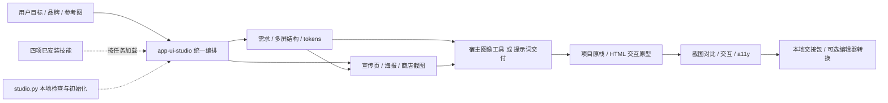

# 架构与交付映射

唯一入口技能持有阶段状态；项目既有设计系统是事实源，插件输出作为补充。没有新增后台进程、远程 MCP、自动安装器或 hook。

## 1.2 SaaS 可选模式

`app-ui-studio saas` → 项目 scope（auto/new/existing/mixed）→ 表面 product/marketing/both → tone（calm/tech-refined/tech-expressive）→ 四技能共享决策 → Lovart / image 独立素材任务 → 真实组件接入 → 渲染与交互证据。普通 APP 与现有 marketing 模式保留原路由，不强制转成 SaaS。

模式说明由 `references/saas-mode.md` 持有；提供方协议继续由 `references/media-tools.md` 持有；`assets/saas-presets.json` 提供本地可读配置，`assets/saas-prompt.md` 提供可复制入口。`studio.py preset` 不检测或修改项目、不生成图片。`init --mode saas` 生成空白项目交接模板；`check` 保持旧 schema 兼容，额外检查已请求 provider 的产物、组件路径与证据文件契约，始终不把文件存在性当成视觉验收。

| Epic | Feature | Task | Test / 证据 |
|---|---|---|---|
| 方法落地 | 品牌到交互界面 | 文章映射、统一入口、条件式 prompts | 原文核对；独立场景推演 |
| 宣传设计 | 品牌一致的推广交付 | marketing 路由、真实产品素材、行动入口 | 手机/桌面与链接检查要求；概念图和实际屏幕区分 |
| 媒体协作 | Lovart / image 可选调用 | 账户选择、参考上传、异步状态、实际预览与降级 | 当前工具 schema 对照；不得把 pending 或图像当交互验收 |
| 技能协作 | 保留四项技能 | 发现、完整职责、冲突优先级、缺失降级 | doctor 与前后 SHA-256 |
| 本地效率 | 可复用辅助脚本 | 初始化模板；对比度；只读环境检测 | 真实脚本运行；负向不覆盖验证 |
| 可信交付 | 可编辑交接与验收 | 状态分层；截图和图层证据规则 | 未执行不得标通过；独立只读评审 |
| 插件交付 | 私有可发现插件 | portable manifest、归档、账户保存 | JSON/YAML/引用/归档校验；保存后读回 |
| SaaS 模式 | 新建/已有/混合与科技视觉 | 可选路由、三档 tone、产品/宣传分面 | scope 与表面的 preset 实测；独立场景推演 |
| 实际媒体协作 | Lovart + image 双链路 | 计划、生成、查看、落地、接入、验证 | 证据缺失/路径越界拒绝；真实生成待项目任务 |

验证与回执保留在包外的 `app-ui-studio-evidence` 目录，避免把本机路径和运行日志上传到插件。`.harness2/` 仅为本地开工评估状态，不进入插件归档。

## 2.0 配方与组合层

软件功能与行业配置由assets持有；scripts/prompt_library.py按需读取命中记录，合并scope/surface/tone与共同技能和媒体链路；studio.py保留旧CLI并注册catalog/prompt/export-prompts。仅营销面裁剪后台页面/状态/业务交互验收；行业事实约束仍保留。导出先构造全部内容，拒绝已有目标、非法slug与越界路径；失败时清理本轮新建目录。

初始技能清单仅暴露一个简短入口，36份提示词不注入初始上下文。上游四技能仍独立安装，不复制、不覆写。Harness²实验与UI样例在包外隔离保存；完整性/确定性回归、素材生成、实际浏览器验证和生产验收分别报告。

## 2.1 合并与证据比较

保留2.0软件/行业提示词库、catalog/prompt/export-prompts和既有设计流程，合并1.3版本冻结、同状态捕获、媒体阶段区分和compare命令。比较文件契约不证明视觉质量，详细规则见 `skills/app-ui-studio/references/comparison.md`。
