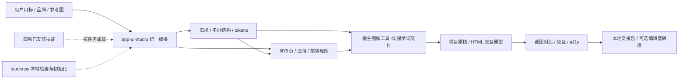

# 架构与交付映射

唯一入口技能持有阶段状态；项目既有设计系统是事实源，插件输出作为补充。没有新增后台进程、远程 MCP、自动安装器或 hook。

## 2.9 默认流程与发现

SKILL和workflow在界面任务中优先实际安装的组合入口与Oil UI Pro，APP UI Studio保持同一任务编排，组合入口分派规范、unslop精修及Web质量参考；用户明确换设计者时不再用Oil重开方向。辅助技能复用有效证据、只返回当前阶段。生成器不读取项目或技能、不联网执行；设计质量意图的skills_loaded/verification_executed始终false。素材/文案/规范对象不因新默认进入页面流水线。

doctor在原四技能输出之外增补六项设计质量候选，支持自定义CODEX_HOME及Oil的.agents优先、.claude回退；仅对确切入口读取哈希，不递归扫描或执行技能。不可读入口保留错误类型，不阻断其他候选，宿主是否启用仍unknown。

工作台位置批注通过原生ValidityState与空白文本规则校验，失败后对齐字段状态、说明和焦点，修正时清理；不新增服务或改变反馈数据版本。

## 2.8 功能契约与设计规范

workflow只在产品扩展或frontend专项的实际范围中加入八项工程契约；audit/brief保留观察/计划模式，契约验证标记始终false。素材和局部组件任务不展开后台链路。现有product-implementation持有接线、类型/作用域、错误恢复和完成定义，不复制整份通用AGENTS规则。

design-system专项为规范/映射对象，默认brief，显式制作允许规范文件但产品implementation/product_changes为false。design-system参考与原创模板按需读取，既有规范优先；不内置第三方品牌值、字体、站点资产或格式执行器。生成提示词、实际文件、渲染和功能验证继续分开。

## 2.7 Web质量与报告边界

web-quality专项默认audit，按需读取现代平台方法和固定来源目录，不联网、安装或执行上游。web_quality.py通过studio.py注册web-report，复用严格JSON读取，只导入单个Lighthouse LHR；0分、缺失、手工和运行错误保留。比较守卫版本、设备、节流、缓存、浏览器、审计范围和URL实际值；只输出摘要，不暴露URL查询或原始DOM。不满足条件不产出差值，文件契约与实际运行、视觉、现场指标分开。

## 2.6 真实产品验证

共享视觉变量在 assets/studio-ui.css，comparison_board构建时内联CSS与状态脚本，仍交付便携单HTML和不变的board.json。桌面适合窗口、手机适合宽度，位置以原图百分比保存；图像就绪且原始尺寸匹配后才允许保存。手机使用单一弹层滚动及输入跳转，避免小预览和嵌套滚动。

源码仓库另有site产品介绍页，scripts/build_site.py将本地素材、共享CSS和真实board输出构建到全新目录，不部署、不生成媒体。叙事默认静态，正常宽屏才启用sticky舞台；rAF按需运行，页面隐藏与离开清理，刷新按当前位置恢复。构建及位置函数有回归，真实浏览器证据与独立看图评审保存在仓库evidence/v2.6.0，不进入插件包。

## 2.2 范围与领域层

2.5的board模板在assets/comparison-board.html，独立撰写的board_feedback.js同时承载浏览器状态模型与页面接线；模型由Node回归，页面以真实浏览器验证。意见按截图身份而非当前推荐选择存储，以board_id隔离本标签页草稿；PNG/JPEG字节、尺寸与归一化位置由board-feedback只读复核。生成页面仍为离线单HTML，不增加服务、外部注入或自动回改。

2.4通过assets/design-capabilities.json提供16项方法配置，按需路由至四份专项指导。oil_ecosystem只读取本地配置与assets/oil-projects.json，不联网、安装或执行上游；来源目录区分Fork、许可依据、元数据盘点与提交定位。workflow共享配置，analysis/review默认只读、术语默认brief，其他专项只组织对应对象的实施，不展开通用整站流程。新配置不改动冻结的软件/行业提示词配方。

2.3的专项由workflow的focus按需路由到component-craft、media-tools、motion-scroll、exploration与iteration；audit使用观察维度，brief交付方案且关闭产品实现意图，制作模式才输出实施配方。comparison_board复用既有严格JSON、目录边界和PNG/JPEG尺寸检查，验证完输入后仅排他创建新对比目录；生成的页面只管理本地选择意见，不能触发业务写入。compare继续承担冻结证据契约，二者都不认证视觉质量。

`references/design-craft.md`持有精修/扩展/还原/审查边界、逐页领域与代表页铺开规则，`quality-handoff.md`持有分层评审。`scripts/design_workflow.py`通过studio.py的workflow命令生成相应提示词，按需复用软件/行业配置；不检查或写入用户项目、不调用模型。原prompt_library.py与冻结输出保持原样。新命令的意图字段不构成执行权限或验收回执。

## 1.2 SaaS 可选模式

`app-ui-studio saas` → 项目 scope（auto/new/existing/mixed）→ 表面 product/marketing/both → tone（calm/tech-refined/tech-expressive）→ 四技能共享决策 → Lovart / image 独立素材任务 → 真实组件接入 → 渲染与交互证据。普通 APP 与现有 marketing 模式保留原路由，不强制转成 SaaS。

模式说明由 `references/saas-mode.md` 持有；提供方协议继续由 `references/media-tools.md` 持有；`assets/saas-presets.json` 提供本地可读配置，`assets/saas-prompt.md` 提供可复制入口。`studio.py preset` 不检测或修改项目、不生成图片。`init --mode saas` 生成空白项目交接模板；`check` 保持旧 schema 兼容，额外检查已请求 provider 的产物、组件路径与证据文件契约，始终不把文件存在性当成视觉验收。

| Epic | Feature | Task | Test / 证据 |
|---|---|---|---|
| 方法落地 | 品牌到交互界面 | 文章映射、统一入口、条件式 prompts | 原文核对；独立场景推演 |
| 宣传设计 | 品牌一致的推广交付 | marketing 路由、真实产品素材、行动入口 | 手机/桌面与链接检查要求；概念图和实际屏幕区分 |
| 媒体协作 | Lovart / image 可选调用 | 账户选择、参考上传、异步状态、实际预览与降级 | 当前工具 schema 对照；不得把 pending 或图像当交互验收 |
| 技能协作 | 保留四项技能 | 发现、完整职责、冲突优先级、缺失降级 | doctor 与前后 SHA-256 |
| 本地效率 | 可复用辅助脚本 | 初始化模板；对比度；只读环境检测 | 真实脚本运行；负向不覆盖验证 |
| 可信交付 | 可编辑交接与验收 | 状态分层；截图和图层证据规则 | 未执行不得标通过；独立只读评审 |
| 插件交付 | 私有可发现插件 | portable manifest、归档、账户保存 | JSON/YAML/引用/归档校验；保存后读回 |
| SaaS 模式 | 新建/已有/混合与科技视觉 | 可选路由、三档 tone、产品/宣传分面 | scope 与表面的 preset 实测；独立场景推演 |
| 实际媒体协作 | Lovart + image 双链路 | 计划、生成、查看、落地、接入、验证 | 证据缺失/路径越界拒绝；真实生成待项目任务 |

验证与回执保留在包外的 `app-ui-studio-evidence` 目录，避免把本机路径和运行日志上传到插件。`.harness2/` 仅为本地开工评估状态，不进入插件归档。

## 2.0 配方与组合层

软件功能与行业配置由assets持有；scripts/prompt_library.py按需读取命中记录，合并scope/surface/tone与共同技能和媒体链路；studio.py保留旧CLI并注册catalog/prompt/export-prompts。仅营销面裁剪后台页面/状态/业务交互验收；行业事实约束仍保留。导出先构造全部内容，拒绝已有目标、非法slug与越界路径；失败时清理本轮新建目录。

初始技能清单仅暴露一个简短入口，36份提示词不注入初始上下文。上游四技能仍独立安装，不复制、不覆写。Harness²实验与UI样例在包外隔离保存；完整性/确定性回归、素材生成、实际浏览器验证和生产验收分别报告。

## 2.1 合并与证据比较

保留2.0软件/行业提示词库、catalog/prompt/export-prompts和既有设计流程，合并1.3版本冻结、同状态捕获、媒体阶段区分和compare命令。比较文件契约不证明视觉质量，详细规则见 `skills/app-ui-studio/references/comparison.md`。
